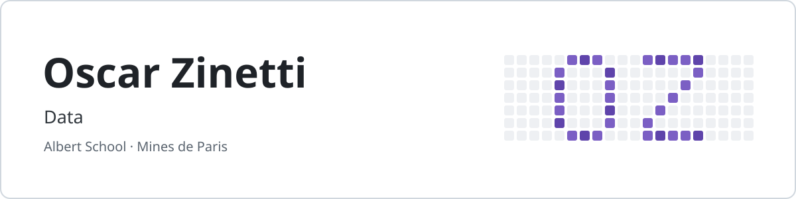

<picture>
  <source media="(prefers-color-scheme: dark)" srcset="assets/banner-dark.svg">
  <source media="(prefers-color-scheme: light)" srcset="assets/banner-light.svg">
  
</picture>

I'm a second-year student at **Albert School** in Paris. I build tools on top of LLMs, then check where they fail: made-up answers, prompt injection, and questions they should refuse to answer.
